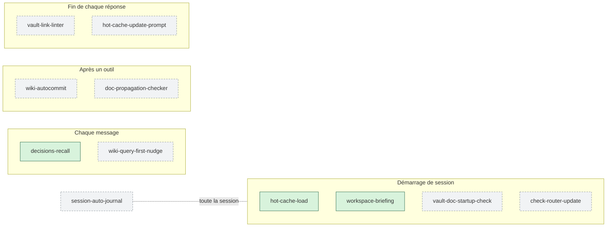

# 14 · Guide des hooks

> Cette fiche est l'aide de la section **Hooks de ce workspace** du panneau des vaults (roue dentée ⚙ → Hooks de ce workspace). Elle dit, pour chacun des onze hooks du router, **à quoi il sert**, **quand l'activer** et **ce qu'il fait concrètement** : s'il lit seulement, s'il écrit, s'il peut bloquer une réponse, s'il va sur le réseau. Pour l'historique et le fonctionnement interne détaillé, voir la [fiche 12](12-hooks-et-automatisations.md).

## Un hook, c'est quoi ?

Un hook est un petit programme que Claude Code lance **tout seul** à des moments précis d'une session : au démarrage, quand vous envoyez un message, après un outil, à la fin d'une réponse. Là où une consigne écrite dans un `CLAUDE.md` peut être oubliée par le modèle, un hook s'exécute **à chaque fois**, mécaniquement.

Le router en livre onze, en deux familles :

- **Trois hooks toujours actifs.** Ils ne font que **lire** : pas d'écriture, pas de réseau, jamais de blocage, et ils restent muets si vous n'avez aucun vault. Ils tournent dans tous vos projets dès que le plugin est installé.
- **Huit hooks au choix, désactivés par défaut.** Ils écrivent (dans git, dans un vault), bloquent parfois une réponse, ou vont sur le réseau. Vous les activez **projet par projet**, depuis le panneau. Un hook activé dans un projet ne tourne pas dans les autres.

## Les onze en un coup d'œil

| Hook | Famille | Quand il se déclenche | Ce qu'il fait, en une ligne | Lit / écrit / bloque / réseau |
|---|---|---|---|---|
| [`hot-cache-load`](#hot-cache-load) | toujours actif | démarrage, après un compactage | charge le résumé des sujets récents du vault | lit |
| [`workspace-briefing`](#workspace-briefing) | toujours actif | démarrage, après un compactage | dit à quels vaults ce projet est lié, et si la recherche sémantique marche | lit |
| [`decisions-recall`](#decisions-recall) | toujours actif | à chaque message | rappelle les décisions déjà tranchées qui touchent la demande | lit |
| [`wiki-query-first-nudge`](#wiki-query-first-nudge) | au choix | à chaque message | pousse Claude à chercher dans le wiki avant de répondre | lit · ≈ 2 000 tokens par message |
| [`session-auto-journal`](#session-auto-journal) | au choix | toute la session | écrit un journal de chaque session dans le vault | **écrit** (vault) |
| [`wiki-autocommit`](#wiki-autocommit) | au choix | après chaque écriture dans le vault | committe le wiki dans git | **écrit** (git) |
| [`vault-link-linter`](#vault-link-linter) | au choix | fin de chaque réponse | refuse une réponse dont les liens vers le vault ne sont pas cliquables | **bloque** |
| [`hot-cache-update-prompt`](#hot-cache-update-prompt) | au choix | fin de chaque réponse | refuse de finir tant que le résumé des sujets récents n'est pas à jour | **bloque** |
| [`doc-propagation-checker`](#doc-propagation-checker) | au choix | après un `git commit` | signale la doc (CHANGELOG, wiki) en retard sur le code | lit |
| [`vault-doc-startup-check`](#vault-doc-startup-check) | au choix | démarrage | même contrôle, une fois en début de session | lit |
| [`check-router-update`](#check-router-update) | au choix | démarrage, une fois par 24 h | signale qu'une nouvelle version du router existe | **réseau** (GitHub) |



*En vert, les trois hooks toujours actifs ; en gris pointillé, les huit au choix.*

## Activer ou désactiver un hook

1. Ouvrez le panneau des vaults (`/vaults`), puis la **roue dentée ⚙**.
2. Section **Hooks de ce workspace** : les trois hooks toujours actifs sont marqués « ✓ toujours actif » ; chacun des huit autres a un interrupteur **Désactivé / Activé**.
3. Le choix vaut **pour ce projet seulement** (le dossier de la session). Il prend effet au prochain événement ; pour un hook de démarrage, à la prochaine session.

Le choix est rangé dans `workspace-hooks.json`, à côté de la configuration du router, jamais dans le projet : un dépôt cloné ne peut donc pas activer chez vous un hook qui committe ou qui bloque.

**« installé globalement ».** Une ancienne version du router (ou `setup-vault.mjs --install-hooks`) écrivait ces hooks dans `~/.claude/settings.json`, ce qui les fait tourner dans **tous** les projets. Le panneau les signale alors « installé globalement », sans interrupteur. Pour revenir au réglage projet par projet :

```bash
node scripts/setup-vault.mjs --uninstall-hooks
```

Chaque hook a aussi une **variable d'environnement** qui le coupe partout (indiquée plus bas). Elle reste utile pour couper un des trois hooks toujours actifs, qui n'ont pas d'interrupteur.

---

## Les trois hooks toujours actifs

### `hot-cache-load`

**À quoi il sert.** Chaque nouvelle session repart de zéro. Ce hook fait retrouver à Claude, sans que vous ayez à le répéter, où en étaient les sujets du moment.

**Ce qu'il fait.** Au démarrage de la session et après un compactage du contexte, il charge le fichier `wiki-meta/hot.md` du vault — le résumé des dernières notes touchées — dans le contexte de Claude. Dans un projet de code lié à un vault, c'est le `hot.md` **du vault** qui est chargé, étiqueté comme tel.

**Concrètement.** Lit un fichier. Muet sans vault.
Pour le couper : `OBSIDIAN_ROUTER_NO_HOT_CACHE_LOAD=true`.

### `workspace-briefing`

**À quoi il sert.** Savoir dès la première ligne **dans quel vault ce projet va écrire**, et si la recherche sémantique de ce vault fonctionne vraiment.

**Ce qu'il fait.** Ouvre la session par quelques lignes : le vault principal et les vaults secondaires liés, ce que le `.env` du projet a proposé et s'est vu refuser, le mode d'enrichissement du wiki. Il signale aussi les deux états où la recherche sémantique est cassée sans que rien d'autre ne le dise : Smart Connections installé mais pas activé, ou activé avec un index vide.

**Concrètement.** Lit la configuration et le disque des vaults liés (même Obsidian fermé). N'écrit rien.
Pour le couper : `OBSIDIAN_ROUTER_NO_BINDING_BRIEFING=true` (tout le briefing) ou `OBSIDIAN_ROUTER_NO_SEMANTIC_READINESS=true` (le seul contrôle de la recherche sémantique). Ces variables se posent sur la machine, pas dans le `.env` du projet.

### `decisions-recall`

**À quoi il sert.** Éviter qu'une nouvelle session re-propose une approche **déjà écartée**. Les décisions écrites dans le wiki ne servent que si quelqu'un les ressort au bon moment.

**Ce qu'il fait.** À chaque message substantiel, il retrouve les décisions tranchées du wiki dont le sujet recoupe votre demande, et les présente à Claude : titre, verdict en une ligne, périmètre, chemin de la page. Une décision à réexaminer est marquée ⏳ ; une décision dont la période d'application est finie, 📅. Le texte des pages est présenté comme une citation, jamais comme une instruction.

**Concrètement.** Lit le wiki, sans appel au modèle ni au réseau, dans un budget de temps fixe. Muet quand rien ne correspond.
Pour le couper : `OBSIDIAN_ROUTER_NO_DECISIONS_RECALL=true`.

---

## Les huit hooks au choix

### `wiki-query-first-nudge`

**À quoi il sert.** Le pire gaspillage d'une base de connaissances : poser une question dont la réponse y est déjà, et recevoir une réponse réinventée à la place.

**Ce qu'il fait.** À chaque message, il rappelle à Claude de consulter d'abord le wiki (index, pages pertinentes, recherche sémantique). Dans un projet de code lié à un vault, il donne aussi les chemins réels du projet et du vault, pour éviter les chemins qui mélangent les deux.

**Quand l'activer.** Dans un projet dont le vault contient vraiment le savoir utile (documentation, décisions, notes de recherche).
**À savoir.** Il ajoute environ 2 000 tokens à chaque message.
**Concrètement.** Lit. N'écrit rien, ne bloque rien.
Pour le couper partout : `OBSIDIAN_ROUTER_NO_WIKI_QUERY_FIRST=true`.

### `session-auto-journal`

**À quoi il sert.** Garder la mémoire des sessions : trois semaines plus tard, retrouver ce qui a été décidé, et pourquoi.

**Ce qu'il fait.** Tout au long de la session, il tient un journal détaillé sous `wiki-meta/Sessions/` dans le vault, et ajoute une récapitulation de deux lignes à `wiki-meta/journal.md` à la fin. Une session terminée sans journal est rattrapée à la suivante.

**Quand l'activer.** Dans les projets dont vous voulez garder l'historique dans le vault.
**À savoir.** Le journal recopie vos messages et un résumé des commandes. Les secrets qu'il reconnaît (mots de passe passés en option, jetons, en-têtes d'authentification…) sont masqués avant d'être écrits. Dans une session qui manipule des secrets exprès, désactivez-le.
**Concrètement.** **Écrit** dans le vault.
Pour le couper partout : `OBSIDIAN_ROUTER_NO_SESSION_JOURNAL=true`.

### `wiki-autocommit`

**À quoi il sert.** Avoir un historique et un retour arrière sur le wiki, sans faire de git à la main.

**Ce qu'il fait.** Après chaque écriture dans le vault par le router, il committe `wiki/`, `wiki-meta/`, `.raw/` et `.vault-meta/` dans le dépôt git du vault.

**Quand l'activer.** Dans une session ouverte **dans le dossier du vault lui-même**, quand ce vault est un dépôt git.
**À savoir.** Il ne fait rien dans un projet de code simplement lié à un vault : il ne committe que si le dossier de la session est un vault wiki sous git, et seulement s'il y a quelque chose à committer.
**Concrètement.** **Écrit** dans l'historique git du vault.
Pour le couper partout : `OBSIDIAN_ROUTER_NO_WIKI_AUTOCOMMIT=true`.

### `vault-link-linter`

**À quoi il sert.** Que les fichiers du vault cités dans une réponse soient des **liens qui s'ouvrent vraiment** dans Obsidian. Un chemin tapé en texte brut devient un lien cassé à l'affichage ([fiche 10](10-liens-et-navigation.md)).

**Ce qu'il fait.** À la fin de chaque réponse, il lit le texte et repère les mentions de fichiers du vault qui ne sont pas au bon format. S'il en trouve, il **refuse la réponse** et donne à Claude la forme correcte ; Claude la réécrit avant que vous ne la voyiez.

**Quand l'activer.** Dans les projets où Claude vous renvoie souvent vers des notes du vault.
**Concrètement.** **Bloque** la fin d'une réponse fautive (code de sortie 2), le temps de la corriger.
Pour le couper partout : `OBSIDIAN_ROUTER_NO_LINT_VAULT_LINKS=true`.

### `hot-cache-update-prompt`

**À quoi il sert.** Que le résumé des sujets récents (`wiki-meta/hot.md`, chargé par `hot-cache-load`) reste à jour. « Pense à rafraîchir le résumé » est exactement le genre de consigne qu'un modèle oublie.

**Ce qu'il fait.** Si la session a écrit une note dans `wiki/` sans rafraîchir ensuite le `hot.md` de ce vault, il **refuse de finir la réponse** tant que ce n'est pas fait.

**Quand l'activer.** Dans les projets où Claude écrit régulièrement dans le wiki, en complément de `hot-cache-load`.
**Concrètement.** **Bloque** la fin d'une réponse (code de sortie 2) jusqu'au rafraîchissement.
Pour le couper partout : `OBSIDIAN_ROUTER_NO_HOT_CACHE_GUARD=true`.

### `doc-propagation-checker`

**À quoi il sert.** Que la documentation ne décrive pas un produit qui n'existe plus : on livre une fonctionnalité, on oublie le CHANGELOG ou la page du wiki, et trois versions plus tard tout a dérivé.

**Ce qu'il fait.** Après chaque `git commit` lancé dans la session, il compare la documentation (CHANGELOG, ROADMAP, pages du wiki du projet) à l'état du code, et signale ce qui est en retard pendant que le contexte est encore frais.

**Quand l'activer.** Dans un dépôt de code qui tient sa documentation dans un vault.
**Concrètement.** Lit et signale. Ne bloque jamais.
Pour le couper partout : `OBSIDIAN_ROUTER_NO_DOC_PROPAGATION_CHECK=true` (coupe aussi le suivant).

### `vault-doc-startup-check`

**À quoi il sert.** Découvrir **en début** de session que la documentation du vault est en retard, et non au moment où on en a besoin.

**Ce qu'il fait.** Le même contrôle que `doc-propagation-checker`, lancé une fois au démarrage. Il ne répète pas un constat déjà fait tant que rien n'a changé.

**Quand l'activer.** Avec `doc-propagation-checker`, dans les mêmes projets.
**Concrètement.** Lit et signale. Ne bloque jamais.
Pour le couper partout : `OBSIDIAN_ROUTER_NO_DOC_STARTUP_CHECK=true` (ou la variable du précédent, qui coupe les deux).

### `check-router-update`

**À quoi il sert.** Ne pas rester sur une vieille version du router sans le savoir.

**Ce qu'il fait.** Au plus une fois par 24 heures, il compare la version installée à celle publiée sur GitHub et vous prévient au démarrage si une mise à jour existe. Il signale aussi un hook apparu avec une mise à jour. Avec `OBSIDIAN_ROUTER_AUTO_UPDATE=true`, il applique lui-même la mise à jour.

**Quand l'activer.** Dans un projet que vous ouvrez souvent : une fois suffit, l'avis vaut pour toute la machine.
**Concrètement.** **Réseau** : une simple lecture sur `raw.githubusercontent.com`, sans télémétrie. Garde la date du dernier contrôle dans un fichier de cache.
Pour le couper partout : `OBSIDIAN_ROUTER_NO_UPDATE_CHECK=true`. Il se coupe aussi tout seul dans un déploiement multi-utilisateur, où l'administrateur gère les mises à jour.

---

## Pour aller plus loin

- [Fiche 12 · Hooks et automatisations](12-hooks-et-automatisations.md) : le pourquoi de chaque hook, ses garde-fous et son histoire.
- [`hooks/`](../../hooks/) : le code des hooks ; [`hooks/hooks.json`](../../hooks/hooks.json) : ce que le plugin déclare ; [`hooks/opt-in-gate.mjs`](../../hooks/opt-in-gate.mjs) : la garde qui ne lance un hook au choix que dans un projet où il est activé.
